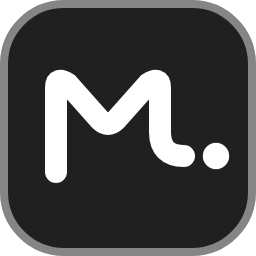

# Mlash

轻量的 Windows x64 mihomo 桌面客户端。通过首页连接和选节点，在配置页管理来源、更新和规则，在数据页查看流量、连接、网站响应与日志。支持托盘、密码备份和可选的 Windows TUN。

[下载预发布](https://github.com/downdone/mlash/releases) · [详细使用指南](docs/getting-started.md) · [文档导航](docs/README.md)

## 开始使用

1. 下载并完整解压 Windows x64 便携 ZIP，运行 `Mlash.exe`。
2. 在「配置」导入订阅 URL 或本地 YAML，点击新配置的「使用」。
3. 回到「首页」选择节点，按需开启代理。

升级、备份与故障处理见[使用指南](docs/getting-started.md)。版本与正式发行资格见[项目状态](docs/project-status.md)，平台能力及实际覆盖见[兼容矩阵](docs/compatibility-matrix.md)。

## 开发与许可

项目使用 C++20 和 Qt 6 Widgets。依赖版本、来源及哈希由 [依赖锁定清单](dependencies.lock.json) 维护。[构建、测试与打包](docs/development/build.md) · [架构](docs/architecture.md) · [变更记录](CHANGELOG.md)

Mlash 采用 [GPL-3.0-or-later](LICENSE)，组件与资源的许可及署名见[第三方清单](licenses/README.md)。

Mlash is an independent third-party client with no affiliation with Clash or MetaCubeX.
