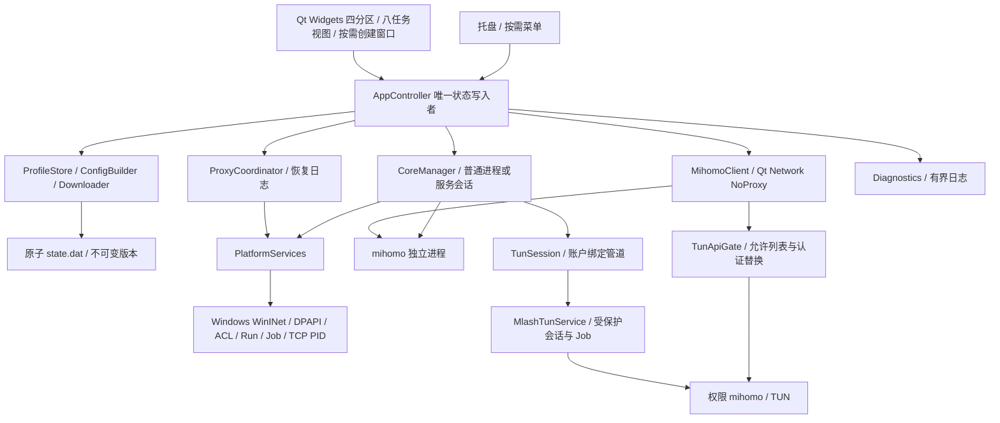

# Mlash 架构与详细设计

当前总体契约；功能的有界字段、计划与取消细则见 [功能模块契约](development/feature-contracts.md)。需求偏差由 [ADR](adr/README.md) 解释，实际验证由 [验证报告](verification-report.md) 记录。

## 1. 进程与依赖图



便携包包含客户端、按需安装的 MlashTunService 和所管理的 mihomo；测试程序、Qt Test 和 yaml-cpp 源码不打包。
Mlash.exe 的 FileDescription 和 ProductName 均为 Mlash。mihomo 仍是 QProcess 启动的独立子进程，
普通模式使用 Windows Job 管理生命周期；TUN 模式由单独 SCM 权限服务拥有 Job。服务保留安装但核心绑定客户端心跳/管道，不能脱离客户端无限运行。任务管理器分组显示不是父子进程契约。
界面不持有 Windows 句柄、文件事务或子进程；所有动作通过 Controller 方法。一级导航按首页/配置/数据/设置组织，域内使用原八个视图 ID；窗口只保存有限分区浏览位置，跨页导航同步页签及分区，不增加持久化字段。

## 2. 模块契约

| 模块 | 实现 | 输入 / 输出 |
|---|---|---|
| app | AppController / Types / Async | 命令 → 观测状态、operationFinished、profilesChanged |
| app | ProfileMaintenance | 有界到期/文件变化 → Controller 维护命令；不写业务索引 |
| app | WebsiteTests | 指定叶子/内置目标 → 有界响应延迟会话；Controller 命令控制，GUI释放清空，无磁盘历史 |
| app | ConnectionSession | 可见快照/单调时间 → 有界活动/离开行、真实累计/差值速率；不写磁盘 |
| core | CoreManager | 启停/校验 → 真实生命周期、就绪、崩溃 |
| core | TunSession / TunPolicy / TunApiGate | 受限服务会话、受控配置、允许列表 API 转发；原生特权实现留在 platform/windows |
| core | MihomoClient | REST / 日志流 → Result、增量日志 |
| profile | ConfigBuilder | 原始 YAML + 设置 → 受控配置、Provider 下载清单、脱敏值 |
| profile | SubscriptionDownloader | URL → 验证过地址/证书的有界字节流 |
| profile | ProfileStore | 版本、设置、索引 → 加密原子持久化 |
| platform | ProxyCoordinator | 接管/恢复 → 所有权、冲突、恢复日志 |
| platform/windows | WindowsServices | WinINet、HKCU Run、Job、DPAPI、私有 ACL、TCP 端口 PID |
| diagnostics | Diagnostics | 应用/内核记录 → 2000 行视图、轮转文件 |
| ui | GuiHost / MainWindow / WebsiteTestsPage / ProxyTableModel / TrayController | 按需创建/销毁窗口；状态 → Qt 标准控件；用户动作 → Controller |
| ui | ImportDialog | URL/文件/名称输入 → 确认后的 Controller 导入命令；取消不产生网络请求 |

`Result` 包含 ok/error/data；运行态对象只允许 Controller 写入。PlatformServices 返回观测值，不更改 AppState。
共享文件模块只有逻辑串行任务使用；日志写入有独立线程。平台注入接口用于测试，生产入口选择真实实现。

## 3. 线程、生命周期、取消

- QApplication 主线程：Widgets、QNetworkAccessManager/Reply、QProcess、状态发布、短命令协调。
- 最多两个全局 worker：文件 I/O、YAML 解析、机密处理、代理/自启读取和写入。
- 一个日志线程：串行追加/轮转；待写队列最多 512 项，视图最多 2000 行。
- worker 捕获值和共享服务，完成结果经 queued invoke 返回主线程；QPointer 检测接收者是否存活。
- 写命令以 busy 串行化，不排无界队列；拒绝重复状态写入。generation 丢弃过时只读结果。
- UI 将 busy 与浏览分开：策略组/节点可选中、过滤/排序/查看，只有 Controller 写动作锁定；测速进度/取消直接显示。settingsDirty 统一应用/还原/关闭草稿判断，未修改不提交，失败规则保存恢复编辑。
- 首页汇总 Controller 状态并路由业务页面；可见时的运行指标由 HomeMetrics 有界采样；组卡片由 QListWidget 委托绘制，连接页签复用有界快照模型。设置以常规、网络与内核、备份与工具分类组织单列有界阅读宽度的滚动分组；搜索先显示分类再异步定位，分类间共享未提交草稿。订阅配置、节点操作、规则和网站/出口诊断按任务页面归属；首页节点预选须显式提交，规则列表和文本共享现有草稿。只组织现有命令与字段，未增加持久化 schema；鼠标/键盘焦点绘制分开，保留键盘语义。
- 应用级输入来源由 WidgetStyle 的 InputSource 维护 keyboardFocus；MainWindow 不再为已取消的双列设置重排安装应用级事件过滤器。组合控件同步编辑器与外壳；鼠标不绘制残留焦点框，键盘保留提示。WidgetStyle 共用 Fusion 代理样式，在应用入口安装，Tray/MainWindow 入口幂等兜底；不以主窗口创建改变托盘风格。组合框配置已有视图与委托，不在样式遍历中替换 view，弹出面板绘制/屏幕范围过滤器由该弹窗拥有，随窗口/菜单树销毁；应用样式不持有窗口引用，不增加轮询或部署模块。单一接受按钮的 visualPrimary 仅控制外观，不改变默认按钮或快捷键；首页主次卡片、连续侧栏、设置分组和规则/连接/日志工具带重排只改变布局，命令与生命周期不变。
- 节点表格与卡片复用同一模型、筛选代理与选择模型；卡片委托按宽度分列，NodePresentation 仅从名称推断地区提示。有限图标缓存由窗口委托拥有，GuiHost 的会话书签保存视图索引，重建恢复；不增加后台网络或存储字段。
- 组列表按需展开，当前组标题常驻；卡片延迟区域由视图处理鼠标命中，QPersistentModelIndex 验证按下/释放目标一致，避免排序/过滤后的误测。单节点命令复用 Controller.testNodes，延迟点击不进入选择/激活流程，忙碌仍允许浏览。
- API configure/cancelAll 增加网络代次，旧内核响应不能写回新运行态。
- 下载 DNS 10s、传输空闲 15s、总请求 30s；配置校验最多 360s（首次 Geo 数据可能串行下载，每项内核允许 90s）；就绪 12s；停止 2s 后 kill。
- 退出期间取消下载/校验/测速并等待正在提交的原子事务收敛，再恢复代理、停止内核。
- 不使用生产嵌套 QEventLoop、waitForStarted、waitForFinished 或同步网络。

启动的目录/单实例锁和端口选择属于有界启动协调；TCP PID/Job 关联是平台层短系统调用。
程序退出事件循环后才等待后台池清理和日志线程结束。
GuiHost 在托盘/展示请求时创建窗口。默认轻量模式关闭窗口接受 close 并删除整个主窗口对象树；保留几何位置、页面号、成员视图索引及不持有 QObject 的有界节点视图书签，所有页面视图/模型/定时器随主窗口销毁。快速重开在旧窗口销毁后排队创建，dispose 以代次撤销排队重开。GUI 析构/隐藏清空规则与连接 UI 快照并停止日志/页面刷新；Controller、Job 管理的内核和托盘继续运行。无托盘关闭走安全退出；规则/设置有未保存内容时确认丢弃或取消。
关闭 lightweight_mode 则仅隐藏窗口。设置字段兼容旧索引缺失时默认 true，仅影响 GUI 生命周期，不重启内核或修改系统代理。Qt/系统可能保留分配器、字体等全局缓存和运行库页面，不以对象释放证明任何特定工作集降幅。
TrayController 从观测 AppState 派生小象状态键，只有键变化才 setIcon；最多懒缓存 13 个 64px QIcon，使用同一品牌静态变体，无动画定时器。busy/意图不代替实际 core/ready/proxy/mode；提示说明实际归属与内核模式，图标不作为节点健康证据。
托盘菜单按打开请求重建；清空 QAction 后显式释放旧子菜单树，防止 Qt addMenu 的 QObject 所有权使旧菜单随打开次数累积。
菜单位置图标按固定地区/组/内置/未知键共享 QIcon，最多 55 种；根菜单重建释放缓存，避免每个节点重复生成位图。
具体组菜单停留 300ms 后可调用 Controller.testTrayGroup；只在展开期间运行，最多 500 个去重成员/三个客户端请求，排除内置直连/拒绝/Pass。Controller 独立只读队列不设置 busy、不自动选节点；写命令 begin、关闭菜单、内核离开 Running、退出时只 abort 自有 reply，代次丢弃旧结果。MihomoClient 返回借用请求句柄以局部取消，不用 cancelAll 影响其他操作。Controller 有界内存缓存最多 500 条，单调时钟 60 秒、操作代次隔离，与 GUI 手测结果共享；不持久化。托盘只增加按展开启停的 single-shot，不创建主窗口，不增加周期性后台任务。已开始的内核探测可能在客户端取消后继续至 5 秒上限。

## 4. 状态机

Core：Stopped → Starting → Running → Stopping → Stopped；启动/运行失败进入 Failed。
`ready` 只在“子进程身份 + API version/config + mixed-port TCP”全部通过后为 true。
API 端口和 Mixed 端口通过 Windows TCP owner PID 表确认属于当前 QProcess，之后才发送 Secret。
节点是否能访问公网是独立测速结果，不参与启动成功判断。

系统代理：Disabled / Owned / External / Unknown；用户意图另存 `desiredProxy`。
Unknown 不等同 Disabled；外部代理/PAC/自动检测不自动抢占。
模式来自 `/configs` 的实际值；组选择来自 `/proxies/{group}` 的实际 now。
手动成员选择回读成功后按 Profile 加密保存，最多 256 组；启动/重启/回滚先重新应用并回读。
原成员已被订阅移除时清理旧记忆并提示采用默认；源 `profile.store-selected: false` 禁用记忆。
自动组的“恢复自动”执行 DELETE，再核验 fixed 为空，清除持久化固定选择。
正常启动可按 restoreProxy 恢复意图；首次没有 Profile，不接管系统代理。
自启观测由 autoStartKnown/autoStartEnabled/autoStartConflict 独立表示；OS 回读优先于旧索引意图，保存失败也不能回显成尚未生效。readOnly 是持续保护状态，诊断导出成功不会清除它。

15s 控制面健康检查仅在内核运行时启用；首页/代理页可见时 8s 按需同步成员，其他页面/隐藏停止该刷新。
成员未变化时保留 Model 索引与选择，不全量 reset；窗口隐藏不保留流量、连接或日志订阅。
连接页可见且内核就绪时，每 2s 获取 /connections，最多一个在途请求、1.5s 超时、最多展示 5000 条。离开页面、隐藏/销毁 GUI 停止定时器、清空快照、递增可见性代次；旧运行代次也不能写回。普通 API 响应仍受 16 MiB 总界限。连接元数据仅在 GUI 内存中显示，不写应用日志或磁盘。
ConnectionSession 同会话差值计算条目/总量速率，首次/回退/超过 10s 缺口为未知；最多 1000 条离开快照记录，截断列表不推断遗漏结束。隐藏/离页/内核代次改变清空，包括详情窗口。关闭全部只在明确确认后执行，GET 验证原 ID 消失，不把新连接当作关闭失败。
规则列表从 /rules 按可见性读取，最多显示 5000 条；离开规则页、隐藏或销毁 GUI 清空，旧可见性代次响应丢弃。GUI 使用 ActivityTableModel 虚拟化连接/规则列表。
可见性进一步限定到实际规则查询页签。连接行 ID/顺序未变时只更新数据，GUI 在行集合变化时按仍有效 ID 恢复选择；关闭单连接要求当前 GUI 快照的 ID，写后独立 GET 确认消失，隐藏期间不留下读取快照。
Core 崩溃/控制面不可用时先检查/恢复代理，再停止/有限重启，单次会话最多两次自动重启。

## 5. 存储与事务

G04：BackupArchive在worker导出/解密/静态校验source和Provider快照；WindowsPortableCrypto只在平台层调用CNG，非WindowsUnsupported。归档不压缩、源字节合计≤32MiB/明文≤64MiB；可选择仅偏好。恢复为新UUID/版本，原子索引提交前不更改旧引用；源/Provider/元数据错误和提交失败清理仅本次新建目录。预览SHA绑定实际恢复文件。恢复前必须核心Stopped且无Owned代理，保留本机核心路径/自启观测，关闭恢复的自动运行/接管/更新意图，不启核心。详细格式和界限由ADR0030维护。

G03：每版本work可选`provider-snapshots.json`为受控相对路径到时间/SHA256/字节/条目数的映射，不含远程URL；下载校验及文件写入后在worker原子更新。配置总提供者≤256。旧版本缺少清单可按需读取文件检查并展示文件时间；有清单的快照复制/激活先比对哈希，损坏不使用。独立刷新从当前候选源构建新版本，只下载所选/同类/全部远程提供者，其余复制冻结字节和元数据；不改active、lastGood或源。全部验证成功才原子保存candidate。错误只在Controller会话内有界缓存≤256项，界面读取不触发下载。

```text
%LOCALAPPDATA%/Mlash/
  instance.lock
  state.dat                    DPAPI：设置 + 完整 Profile 索引
  state.last-good.dat          上次索引的备份；损坏不自动覆盖
  geodata/                     用户提供的本地 Geo 文件及来源/哈希 manifest
  profiles/<profile-uuid>/versions/<version-uuid>/
    source.yaml                原始订阅快照
    work/config.yaml           本版本受控运行配置
    work/providers/*.cache     已检查的 Provider 快照
    work/...                   本版本 mihomo 缓存
  recovery/proxy-journal.dat    DPAPI 恢复记录
  logs/app.log                 5 MiB，每次轮转，最多 5 个文件
```

每份 Profile 的 candidate、active、lastGood 是版本 ID；无显示名拼路径。
QSaveFile 原子替换一个加密 state.dat，一次提交设置、活动 Profile 和版本索引，避免两个 JSON 交叉提交。
Profile索引可选custom_rules/append_rules/disabled_rules为前置/追加/按完整字符串屏蔽原规则，前置+追加合计≤256，屏蔽≤256，每条≤1024字符；缺失为空，保持schema=1兼容，错误类型/超限进入只读保护。按Profile独立合成“前置→未屏蔽原规则→追加”，不改source.yaml，不隐式移动原MATCH；RULE-SET只可引用声明过的rule-provider。内核启动后回读/rules核对总数及前置/追加类型和目标，失败沿既有事务回滚，运行中编辑不应用独立候选源。
同一索引的可选 auto_update 默认 false、update_interval_hours 默认 12（1–168）、source_hash、last_update_attempt、update_error 与 subscription_info 表示明确开启的维护策略、来源字节指纹、尝试/脱敏错误和标准响应头快照；计数字符串避免浮点精度损失。更新策略/用量非法拒绝加载，最多 256 份订阅。
可选 recent_selections 是最多 32 个 group/member 对（各 512 字符），手动回读成功后 MRU 去重保存；rememberSelections=false 清空并不记录，重启恢复不会改变 MRU。设置可选 test_url 仅供手动 5s HTTP 连通/延迟测试，旧状态沿用原默认 URL；非法 URI/字段类型拒绝加载。
文件夹 DACL 只允许当前用户与 SYSTEM，子文件继承；YAML 内有运行 Secret，依靠 ACL 隔离。
DPAPI 数据绑定当前 Windows 用户；“portable”指程序可解压运行，用户数据不能跨账户直接搬迁。
损坏的 state.dat 导致只读保护，保留原文件与备份；不会静默重置再写入。
设置/索引字段严格校验；明文和密文保存前各限制 8 MiB，超限不覆盖旧索引。只读时仍可导出脱敏状态/日志，保留原错误与保护提示。
可选 startup_page/tray_click 为启动/托盘偏好；ipv6_mode/unified_delay_mode 三态默认 source 保持订阅语义。显式 runtime 覆盖需 -t/启动/GET configs 回读，失败恢复旧字段。配置预览在 worker 读取/脱敏，最多 512 Ki 字符，旧代次和隐藏窗口丢弃，不编辑/记录原文。
提交后只保留当前及上一索引引用的版本；未提交的失败版本可在后续成功提交时清理。

### 导入 / 手动更新

下载/文件读取 → YAML 能力检查 → 生成新版本 → 下载并检查 Provider → 实际 `mihomo -t` →
原子提交 candidate。运行中的 active 不变；本地文件删除不影响快照。
本地“同步原文件”与 URL“更新订阅”统一走 updateProfile/refreshSource；文件无变化不创建新版本，读取/校验失败保持 candidate/active。更换文件是独立的显式导入操作；候选待使用、当前运行与重新加载不能混为同一主按钮。
重启、运行字段修改和恢复旧 active 生成运行副本时，保留独立待激活 candidate；只有明确选择它激活才更新该指针。
校验失败不改索引和 active，错误可复制，敏感原始行不进入普通日志。
维护结果元数据可单独保存，失败不改来源版本指针。定时 URL 更新与文件监测始终只生成候选；GUI 释放后继续明确开启的维护，smoke-test/只读/退出禁止维护。URL 共用 60s 粗定时器；文件/父目录监测合并 1s 变化，worker 比较 SHA256，相同字节不重校验。busy 延后处理，到期/失败调度为常数有界状态，失败 5min 起指数退避至 1h，成功清除错误；后台不反复弹通知。
校验期间显示首次 Geo 下载提示；超时与退出取消分别报告。更新/激活/回滚仅在 geox-url 和 geodata-mode 相同时
复制前一版本的 Geo 数据到新版本，限制固定文件名、单文件 128 MiB，不复制 cache.db 或符号链接；不同源重新下载。
`scripts/import-geodata.ps1 -SourceDirectory <目录>` 可导入已有本地 Geo 文件；无自定义 geox-url 的配置优先使用
本地副本，实际 `mihomo -t` 验证所使用的数据。数据不随应用 ZIP 打包，不承诺来源与内核默认在线版本一致；
用户提供数据属于显式离线快照，后续更新通过再次导入完成。自定义 geox-url 不使用这份默认快照。
设置中的 Geo 导入先暂存固定名称、非链接、≤128 MiB 文件与哈希清单，再交换默认目录，保留一份 geodata.previous。重新激活无自定义源时优先使用新默认；失败运行回滚显式复用原版本 Geo，当前版本文件从不被导入覆盖。

### 激活 / 设置中的运行字段变更

自定义规则在 worker 内构建受控配置时按用户顺序前置到原规则。非运行订阅保存前校验，随后等待激活；运行订阅先校验，再沿用激活事务安全重载，/rules 回读前缀类型与目标成功后原子保存。失败不保存新规则并恢复旧运行版本。编辑运行规则使用 active 原始版本，不自动激活尚待更新的 candidate。覆盖意图在更新、启动、源版本回滚时继续合并；回滚来源版本不会撤销当前自定义规则，要撤销规则需清空并保存。

从选中版本 source 和 Provider 快照生成新的受控运行版本 → 校验 → 恢复自有代理 → 停止旧内核 →
启动新内核并核验身份/就绪 → 原子提交 active/settings → 按意图安全恢复系统代理。
跨 Profile 不追求无缝；允许可验证的短时中断。
任何启动/提交失败，在此前确实运行的情况下重建并启动旧版本；成功恢复旧索引后仍返回原操作失败。
新内核成功但代理冲突时，保留真实的新运行态并显示冲突，不能声称整个操作成功。
自启 OS 效果与运行配置有独立提交边界，配置回滚不意味着自启 OS 效果已回滚。

## 6. Windows 接管与恢复

读取完整 WinINet 默认连接快照：flags、server、bypass、PAC → 检查冲突 → 写前记录 before/written/token →
再次检查当前值 → 应用受控代理 → SETTINGS_CHANGED/REFRESH → 回读确认。
关闭、崩溃和下次启动恢复时：当前快照等于 written 才恢复 before；不同保留外部设置并保留日志。
明确允许重新接管外部状态时归档旧日志，重新以此时的外部设置为 before。
Windows 没有跨程序的整组代理 CAS，双重回读降低风险但不能消除全部竞争窗口。
不改 WinHTTP 全局代理，不接管 RAS/VPN 每条连接；企业策略拒绝写入时正常报错。
恢复失败且所有权不明时，普通退出保留内核并报告错误，用户可处理系统设置后重试。
失败退出恢复 exiting/维护/健康检查状态，保留写前日志。恢复前严格验证 schema/UUID/时间及四字段快照；非法内容不写 OS。
外部已接管则可以安全停止自有内核，保留外部设置。
Windows Job 负责限制子进程生命周期；它不能在客户端强杀时替客户端恢复 WinINet。

## 7. 输入能力与网络边界

G02：每订阅 `download_policy` 为 direct/core、可选单行ASCII UA（≤256）及5–120秒总超时，旧索引默认direct/原UA/30秒；索引类型和范围严格校验。URL导入和该订阅所有Provider下载共用策略；core路径要求当前内核已就绪，并在worker确认Mixed端口属于受控PID后才发请求。Qt HTTP代理只连接127.0.0.1，关闭缓存代理能力；HTTP/HTTPS均以CONNECT固定已检查IP，Host/TLS peer保持来源域名，不关闭证书验证。DNS/重定向共享单次下载总预算，传输空闲仍15秒；不隐式回退直连/系统代理。更新设置原子保存，不修改当前运行版本。

- 完整 UTF-8 YAML，8 MiB；单文档 map；拒绝重复键、合并键、特殊 tag、递归/过深别名。
- 未知顶层能力拒绝；支持列表以 ConfigBuilder 为准。无自动订阅格式转换。
- 受控 Mixed/API/Secret/TUN/LAN 字段显式覆盖；拒绝额外 listeners/tunnels/服务器/外部 UI/独立 DNS 监听。
- 不改 DNS/IPv6/规则的剩余语义；外部文件 Provider、证书路径、超出许可协议边界的配置明确拒绝。
- 源 URL 允许 HTTP/HTTPS，优先 HTTPS；最多 4096 编码字节，拒绝 URL 用户信息与片段。HTTPS 重定向不得降级，最多四跳。
- 所有 DNS 结果均需通过回环/内网/保留地址检查；连接固定到检查过的 IP，Host 和 TLS peer name 保持原域名。
- IPv6 采用普通全球单播的保守边界，标准 NAT64 检查嵌入 IPv4；文档/转换/特殊协议段拒绝，少数特殊公网例外不支持，详见 ADR 0015。
- Provider 要求 HTTPS，8 MiB；节点提供者使用YAML，规则使用YAML/text或有界MRS domain/ipcidr。来源指定的provider.proxy仍拒绝，下载使用订阅的direct/core策略。
- 远程 Provider 由客户端下载、检查协议与路径能力，运行配置改为版本内的 file Provider；更新由Profile来源刷新或独立Provider候选刷新触发。
- 已有版本激活/回滚复用冻结的 Provider 字节，不重新从网上取可能变化的内容。
- 原始订阅保留，界面告知受控字段与 Provider 快照策略；无法保证无损的特性明确拒绝。

此边界不是操作系统沙箱。DNS 上游/Geo 数据等内核能力仍遵循经过接受的配置；不承诺任意高级配置全部安全兼容。
源 URL 和认证信息在索引中 DPAPI 加密，日志过滤 URL query/用户信息和已知节点机密。

## 8. 验证与发布边界

自动测试覆盖 API 204/编码/超时/取消，YAML 危险输入，恢复日志顺序/PAC/外部所有权，
Fake Core 生命周期、真实 v1.19.32，实际 Controller 导入与端口占用回滚，以及 GUI 创建/退出。
独立 mlash_ui 静态目标复用 UI 实现；ui_interactions 在临时目录验证导入格式/取消边界、按钮有效性与真核成员选择。
Windows 系统代理实机写入、自启登录、Explorer 重启、休眠、干净机器和 72h 是独立发布验收。
日志级别/暂停仅当前 GUI：暂停/隐藏关闭详细流，应用与必要 Core 输出仍有界记录。清空只移除内存视图；显式导出捕获状态白名单/有界日志/已知敏感值，worker 再次脱敏并原子写 JSON，不读取原始 YAML/来源索引/连接快照。设置 UI 按实际字段与原已显示值更新，不覆盖用户尚未应用的草稿。
只有运行证据可把“实现”升级为“验证”或“发布合格”。
