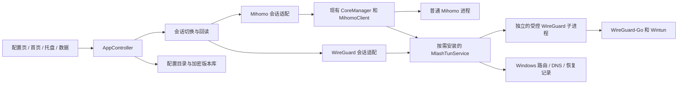

# Mihomo 与 WireGuard 双内核设计

基线是 Mlash 1.23.0 的 Windows 实现与用户提供的 `wireguard-go-0.0.20250522`。Windows 接管权限由 [ADR 0036](../adr/0036-windows-tun-service.md) 和 [ADR 0059](../adr/0059-wireguard-windows-service-scope.md) 定义。配置导入、设备 SDK、服务接管和界面已进入实现与验收。全隧道、断线保护和含 WireGuard 的密码备份仍按后续设计管理。

## 1. 功能定义

用户可在同一份 Mlash 中管理 Mihomo 配置和原生 WireGuard 隧道。两类配置可以同时保存、编辑和备份。首页与托盘显示正在运行的内核及接管方式。显式连接或切换决定哪一种网络会话生效。

| 场景 | 用户输入 | 流量路径和能力 |
|---|---|---|
| Mihomo 代理 | 现有 URL、Clash/Mihomo YAML 或节点链接 | 沿用本地代理端口、系统代理、Mihomo TUN、规则、策略组、Provider、连接与测速。 |
| Mihomo 内的 WireGuard 出站 | Mihomo YAML 中的 `type: wireguard` 节点 | 由 Mihomo 决策选路并发送 WireGuard 流量。与其他节点同属于既有策略组，动态节点能力按锁定 Mihomo 版本验收。独立 WireGuard 后端无需启动。 |
| 独立 WireGuard 隧道 | 本地 `.conf` 或显式粘贴标准配置 | 由 WireGuard 引擎处理 UDP 加密隧道，Windows 接口按目的 CIDR 分流。界面展示 Peer、握手、接口、路由、DNS 与字节计数。 |

增加第四种组合「WireGuard 分流隧道 + Mihomo 本地代理」。两者分别运行，WireGuard 管指定目标网段的系统路由，Mihomo 只接收应用明确发送到本机代理端口的请求。独占模式继续支持显式双向切换。并行模式只有 WireGuard 一个系统路由所有者，Mihomo TUN 关闭，默认保持系统代理设置。详情见[并行运行与流量归属](#并行运行与流量归属)。Mihomo 是支持多种代理协议的内核名称，WireGuard 是隧道协议名称。

## 2. 架构

- `AppController` 保持唯一业务状态写入者，串行管理连接、切换、取消、终止与版本提交。独占与并行模式使用不同接管约束，并行时持有两个运行会话及一个由 WireGuard 占用的系统路由租约。通过各自会话 ID 和代次丢弃旧回调。在 UI 关闭并释放后，Controller 继续持有会话。
- 保留 `CoreApi`、`CoreManager` 和 `MihomoClient` 的 Mihomo 职责，现有 REST 和 `TunApiGate` 只服务 Mihomo。公共抽象放在会话生命周期和观测处。WireGuard 使用独立类型和能力投影。两端有明确的错误和恢复回读。
- Windows 路由、DNS、接口和流量保护的写入由授权服务串行完成。WireGuard 缺失组件允许离线预览和保存，连接前给出能力原因。macOS/Linux 的独立后端返回 `UnsupportedPlatform`。组件安装、服务升级和全隧道过滤能力的执行边界由待评审 ADR 决定。

## 3. 技术选型

| 路径 | 决策 | 依据 |
|---|---|---|
| 固定 Mihomo 及现有 Qt 技术栈 | 延续 | 锁定版本为 `v1.19.32-halfclose.1`，已有普通会话、TUN、YAML 构建、版本验证与回读。锁定版本上补实际 WireGuard 出站用例，尤其是多 Peer、`reserved` 和 DNS 等期望字段。 [Mihomo WireGuard 出站文档](https://wiki.metacubex.one/en/config/proxies/wg/) |
| 用户提供的 Go 实现 + 签名 Wintun | 首版提案 | 本地 `version.go` 为 `0.0.20250522`。`main_windows.go` 创建 Wintun 和 WireGuard 设备并开放调试控制口，工程需补充地址、路由、DNS、所有权和恢复。项目内独立 Go helper 引用固定上游模块，采用库接口和继承的私有控制通道。锁定 Go 工具链、模块来源、`go.sum`、目标 ABI、签名 DLL/驱动与二进制摘要。 [WireGuard-Go](https://git.zx2c4.com/wireguard-go/about/) · [Wintun 签名分发](https://www.wintun.net/) |
| WireGuardNT + 官方 Windows 隧道库 | 比较方案 | 上游 Windows 客户端使用 WireGuardNT，官方嵌入方案提供平台生命周期和部分路由、DNS、过滤策略。若指定 Go 版本的路由、驱动或维护风险达不到门禁，提交对比 PoC 后重新评审后端，配置、UI 与公共接口可沿用。 [官方客户端](https://git.zx2c4.com/wireguard-windows/tree/README.md?h=v1.1.1) · [嵌入服务](https://git.zx2c4.com/wireguard-windows/tree/embeddable-dll-service/README.md?h=v1.1.1) |

本地源码目录作基线对照，正式构建须先验证对应上游提交及文件差异，随后采用仓库管理的可重建依赖。签名驱动候选以官方分发 ZIP 为来源，锁定资产后再变更打包白名单和许可清单。C++ 服务保留 Windows 网络配置、恢复记录和进程所有权，Go helper 负责 Wintun 实例与 UDP 数据面。服务通过固定目录和哈希启动 helper，Job 绑定会话生命周期。用户输入的配置路径、可执行名称、命令行和脚本无法进入该启动接口。

## 4. 模块设计

| 层 | 模块建议 | 责任与边界 |
|---|---|---|
| `src/domain` | `SessionSelection`、`WireGuardProfile`、`SessionObservation` | 定义后端、可用能力、配置版本、路由覆盖、接管状态与握手状态。列表模板不携带私钥或 PSK。 |
| `src/profile` | `WireGuardConfigParser`、`WireGuardStore` | 有界解析、规范化、不可变版本、加密快照与回滚。导入预览无网络请求。已有 Mihomo `ConfigBuilder` 继续处理 YAML。 |
| `src/app` | `AppControllerSessions` | 预检令牌、按模式管理活动会话与系统路由租约、切换事务、恢复阻断、退出、事件归属、按需采样。 |
| `src/core` | `MihomoSession`、`WireGuardSession` | Mihomo 适配现有控制对象，WireGuard 适配受控服务。生命周期回调携带会话和代次，只发布经过归一化的观测。 |
| `src/platform/windows` | 现有 `MlashTunService`、WireGuard 路由计划和恢复记录 | 管道身份、组件验证、Job、接口地址/路由/DNS、出口选择、状态对照及回滚。Win32 网络 API 保持在平台层。 [Microsoft IP Helper](https://learn.microsoft.com/en-us/windows/win32/iphlp/ip-helper-functions) |
| 独立 Go helper | `wireguard-go` 模块、签名 Wintun | 固定启动、创建接口、按已验证参数配置设备、控制 UDP 传输、返回脱敏 Peer 观测。禁止对外暴露上游 `IpcGet` 的完整输出，其中包含密钥；只通过白名单提取计数和握手。 |
| `src/ui` | 复用配置页、首页、数据页、托盘及设置工作区 | 根据当前后端显示相关功能，错误关联发起页面，持久告警走现有底栏。控制命令全部经 Controller。 |

### 存储和兼容性

保留现有 Mihomo 配置及版本目录。WireGuard 使用独立有界对象集合，按随机 UUID 归属配置和不可变版本，分别记录 `candidate`、`active`、`lastGood`。将密钥和原始配置保存在账户加密的私有版本快照，索引仅含身份、摘要和版本引用。先写完整快照，再原子提交引用。失败清理未引用的本次暂存，保留旧对象、候选与在用版本。

WireGuard 首个切片使用独立账户加密目录 `wireguard/`，目录内索引有自己的显式 schema。现有 `state.dat` 保持原契约，旧程序继续读取 Mihomo 索引。WireGuard 索引损坏时保留原文件并禁止 WireGuard 写入，读回实际文件后才提交新候选。统一配置列表组合两类摘要，UI 保存配置与实际启动分开。各后端的活动运行版本分别提交；重新打开 GUI 不改变会话。备份与恢复在两类索引上分别验收。

密码备份增加明确标记的 WireGuard 配置纳入项，默认不包含 WireGuard 私钥，用户显式选择后才进入密码加密归档。涉及省略密钥的恢复显示「需补齐密钥」并禁止连接。跨版本备份保持旧档可读，旧端遇到新格式应明确报告版本。任何备份恢复只恢复配置和可选偏好，启动、系统代理、TUN 及路由接管均需用户重新确认。

## 5. 协议设计

### 5.1 网络协议与 Windows 路由

WireGuard 数据面采用上游协议实现。每个 Peer 通过公钥标识，`AllowedIPs` 参与出站 Peer 选择和入站源地址验证；Mlash 另外将这些前缀转换为 Windows 路由计划并做独立回读。Mihomo 的策略组语义保留在 Mihomo 侧。 [WireGuard Cryptokey Routing](https://www.wireguard.com/#cryptokey-routing) · [WireGuard 协议](https://www.wireguard.com/protocol/)

| 配置域 | 首版兼容提案 |
|---|---|
| `[Interface]` | 必填 `PrivateKey`、一个或多个 `Address`。可选 `DNS`（IP 地址列表）、`MTU`、`ListenPort`。默认 MTU 来源于已验平台策略。端口、地址与 MTU 按实际驱动要求验证，预检列出推导值。 |
| 重复 `[Peer]` | 单个公钥唯一。支持 `PublicKey`、可选 `PresharedKey`、`Endpoint`、`AllowedIPs`、`PersistentKeepalive`。首版按客户端连接设计，每个参与主动连接的 Peer 必须有 Endpoint，支持域名、IPv4 和方括号 IPv6。 |
| 校验规则 | Base64 解码后的公钥／私钥／PSK 均须符合 32 字节约束及语义校验。允许同一 Peer 内规范化去重，跨 Peer 重叠 CIDR 首版报冲突。限制草案为 128 KiB、32 个 Peer、每 Peer 64 个前缀和整份 256 个前缀。错误返回字段和行号，错误文本不回显凭据。 |
| `wg-quick` 扩展 | `PreUp`、`PostUp`、`PreDown`、`PostDown`、`Table`、`SaveConfig`、DNS 搜索域和未知字段给出明确的不兼容提示。标准文本保存在加密快照中，具备清楚的重新导入路径。 [wg-quick 配置语义](https://git.zx2c4.com/wireguard-tools/tree/src/man/wg-quick.8) |

- 分流向用户列出接管的前缀以及仍由 Windows 处理的地址族。对可能被自身路由覆盖的隧道 Endpoint，预检在改路由前解析域名并核对物理出口；启用时对实际使用的 IP/接口确认传输路径，使用有明确所有权的 Endpoint 路由或接口绑定。网络变更时按会话代次重新验证，无法验证则降为「连接受限」并执行对应的保护或清理，不循环启停。
- 分流中只有 `DNS` 已配置且目标受路由计划覆盖时才设置隧道接口 DNS，界面区分「已设置接口 DNS」与「DNS 请求实测经过隧道」。空 DNS 沿用系统行为。IPv4、IPv6 各自记录覆盖范围，单栈与双栈状态分别呈现。外部 VPN、同目的路由和 DNS 冲突在变更前按实际 Windows 观测拦截或明确报告。
- 全隧道 `/0` 由独立验收阶段开放。须明确 IPv4、IPv6、DNS、Endpoint 例外及失败保护的行为。未通过全隧道前的实现对 `/0` 返回能力提示，同时识别低层等效全覆盖的分拆前缀。全流量保护需要经验证的 Windows 防火墙策略和恢复契约；只有路由和 DNS 回读时，UI 只能声称相应路径已配置。 [官方 Windows 路由和过滤行为](https://git.zx2c4.com/wireguard-windows/tree/docs/netquirk.md?h=v1.1.1)

### 5.2 控制协议

提案保持现有 Mihomo v1 管道形态。新版为独立版本化端点，沿用本机管道、SID 绑定、服务 PID 验证、首次实例和帧限时，不靠尝试未知命令猜测能力。旧服务可继续运行既有 Mihomo，WireGuard 显示需升级，且在停止当前会话之前完成版本探测。新旧端点由服务共享同一活动租约。服务到 helper 使用仅继承给指定进程的输入/输出句柄；helper 只认识 WireGuard 配置和设备控制操作。

| 阶段 | 命令 | 关键边界 |
|---|---|---|
| 建立 | `hello` | 握手返回版本、后端、服务能力、组件状态及清理待办。客户端核对服务身份后才发送敏感数据。 |
| 预检 | `prepareWireGuard` | 接收结构化配置计划，校验组件、实际路由冲突和版本，返回绑定本次连接、账户及候选摘要的短期一次性引用。预检可按用户请求解析 Endpoint，保持原运行。 |
| 启动 | `startWireGuard` | 消费有效引用。传递密钥只在已验证私有通道中，服务与 helper 各自限制大小、有效期与生命周期。回复包含会话 ID、代次和脱敏资源观测。 |
| 观测 | `status`、`heartbeat` | 报告资源和健康状态，更新租约。重启、并发写入、错误代次以及超限帧分别拒绝。 |
| 清理 | `stop`、`confirmCleanup` | `stop` 同时核对所有者、会话 ID 与代次。只读清理确认可重连，返回是否存在旧租约、剩余资源与清理结果。确认不会停止其他客户端会话。 |

请求封装建议最少包含 `version`、`requestId`、`operation`，有活动会话时补 `sessionId` 和 `generation`。兼容性、版本冲突、校验及清理失败使用稳定错误码。JSON 帧能力控制消息建议保持 16 KiB，专用结构化配置负载单独限制在 128 KiB；解析前检查长度、完整性和消息期限。缓冲区仅在所需进程短暂保留，原始密钥、PSK、订阅令牌及任意用户输入不进入命令行、环境变量、日志、通用错误或常驻 GUI 状态。恢复记录只需要资源身份和前后观测。协议样例与安全检查在实现前按 ADR 单独冻结。

Go 设备控制子通道采用 4 字节小端长度和 UTF-8 JSON。请求包含 `version`、严格递增的 `sequence`、`operation`，`start` 额外包含结构化配置、MTU 和解析完成的 IP Endpoint。`status` 只返回设备 LUID、端口、Peer ID、握手时间和十进制字符串字节数，`stop` 可重复确认。输入 EOF 时关闭设备，错误使用固定码。传输只消费宿主提供的读写句柄，SDK 使用内存和回环夹具。账户授权、路由、DNS、会话租约和管道身份验证属于服务侧。

Windows 客户端走已认证的本机服务管道，WireGuard 请求头以 v2 区分，附 256 KiB 有界配置，沿用独占服务连接。标准 Mihomo 本地代理无需占用服务连接。Windows 把接口地址按 /32 或 /128 写入以限制隐式链路路由，显式分流前缀来自 AllowedIPs。先检查已有路由、地址族、Endpoint 出接口和 DNS，再创建记录和资源；心跳读回 LUID、地址、分流、Endpoint 选路及接口 DNS。自动断开后再次核验清理。实际读回不等于 Peer 可达或 Windows 所有 DNS 请求均经过隧道。

## 6. 功能设计

主窗、托盘、逐状态文案和 UI 验收见[双内核界面设计](mihomo-wireguard-ui.md)。导入后统一管理配置，详情按类型提供启停。共存预检和提交由两路启停触发，有冲突或接管变化时才需要用户确认。

### 6.1 用户操作

| 页面 | 布局与动作 | 结果及恢复 |
|---|---|---|
| 配置 | 复用紧凑导入栏，按扩展名和文件内容识别 YAML 与 `.conf`。高级入口允许明确选择「Mihomo 配置」或「WireGuard 隧道」和粘贴。 | 先预览名称、Peer 数、地址、路由范围及 DNS。保存产生配置或候选，连接为独立操作。歧义或格式错误保留输入，提示字段。 |
| 首页 | 共用「当前配置」「连接／断开」「切换配置」。Mihomo 保留原有选路与测速。WireGuard 显示 Peer、实际路由覆盖和最近握手。 | 从正在运行的模式切换前显示目标模式、接管范围和可能短暂中断。无流量握手仍可正常处于等待，失败展示具体阶段和可恢复状态。 |
| 配置详情 | WireGuard 显示概要、接口、Peer 清单与版本。支持编辑、候选对比、回滚、删除以及重新读取本地文件。 | 默认隐藏敏感值。版本差异只显示「密钥已变更」，以及地址、Peer、路由和 DNS 变化。正在使用的配置须先断开或切换才能删除。 |
| 数据 | WireGuard 展示隧道总计与各 Peer 累计、最近握手、接口/路由/DNS 观测和日志。 | 数据来自同一会话；重连、计数器回绕及代次变化都重新基准化。Mihomo 的逐连接、规则与节点测速仅在拥有对应能力时出现。 |
| 设置与托盘 | 设置中显示组件与服务版本、安装／升级和清理入口。托盘显示实际模式、连接、断开与打开主窗口。 | 显式 UAC，拒绝权限时保留已有模式。外部系统代理不被覆盖。重启后的自动连接策略继续由既有 Mihomo 配置负责，独立 WireGuard 首版手动连接。 |

### 6.2 切换、回滚与恢复

1. 先准备新配置与逆向恢复所需的旧状态。预检确认可用组件、候选版本、访问范围、Endpoint 出口、网络所有权以及旧会话的恢复条件。
2. 针对实际旧接管方式解除所有权。Mihomo 的 WinINet 使用现有完整快照比较规则。关闭旧内核/隧道并确认 Job、路由、DNS、接口均已按契约清理后，再申请新租约。服务无法确认清理时阻止启动替代会话。
3. 创建新会话，先持久化恢复意图，再执行 Windows 写入。在服务和 Controller 分别核对 PID／Job、接口、实际选路与 DNS。Mihomo 继续按既有内核 API 回读。预检须明确切换条件「本地接管已确认」或「同时验证指定 Peer」。后者要求用户指定 Peer 及其隧道内的验证目的地，目标必须被该 Peer 的 `AllowedIPs` 覆盖。对指定 Peer 发起受限验证并在有限等待内确认，超时撤销目标并回滚。只有自然业务流量时，握手属于后续只读观察。
4. 成功后原子提交活动内核和配置版本。接管与健康状态分别发布。若没有握手证据，显示「接口已启用 · 等待握手」。收到握手只表明该 Peer 已通信，可达性与实际路由仍单独观察。不存在隐式跨协议回退或合并两个后端的配置。
5. 任一步骤失败或取消，先撤销本次创建且仍匹配的 OS 资源，再按旧快照恢复原会话和版本。外部已修改的资源不得盲目覆盖。目标清理不明时停在 `CleanupRequired` 并保留恢复记录，界面提供重试清理。旧模式恢复失败时显示未接管及原因。退出、服务强杀、IPC 断开与系统重启复用同一清理规则。

状态模型同时表达用户选中、已启动、路由生效、Peer 握手和清理待确认。示例 `Idle → Preflight → Switching → Applying → Active/WaitingForHandshake`，异常从发生阶段进入 `RollingBack` 或 `CleanupRequired`。`runId`、计划版本与操作代次共同决定回调是否仍有效。

## 7. 接口设计

下述是边界草图。当前 `MainWindow`、`GuiHost` 和托盘继续通过 `AppController`，互操作的实现可沿用项目既有 `Result`、`OperationId` 与 `Completion` 约定。页面从 `SessionObservation` 与能力列表绑定呈现，禁用项保留明确原因。

| Controller 候选接口 | 输入和回读 | 语义 |
|---|---|---|
| `previewWireGuardFile(path, done)`／`previewWireGuardText(source, done)` | 本地路径或受限粘贴缓冲 → 预览引用、字段错误、脱敏摘要 | 有界 worker，运行无网络、无业务索引写入。引用绑定已解析快照，有效期 120 秒，`cancelWireGuardPreview()` 释放。 |
| `saveWireGuardPreview(name, token)` | 一次性预览引用 → 新配置候选 | 消费已预览的字节，写入加密快照并读回，再更新索引。直接替换入口校验原配置类型及期望候选版本。保存不触发连接。 |
| `prepareSession(selection, done)` | `Backend + profileId + versionId + takeover` → 能力、变更计划、预检引用 | 补足实际环境观测。失败保留当前会话。后端隐式跨用字段拒绝。 |
| `connectSession(planToken)`、`switchSession(planToken)` | 预检引用绑定的目标 → 已提交／回滚／待清理结论 | 消费一次性计划，拒绝过期版本和重复提交。切换要求明确确认。 |
| `disconnectSession(expectedSessionId)`、`cancelSessionChange(opId)` | 期望会话或在途操作 ID → 终止或恢复结果 | 过期请求无副作用。进入不可中断原子写入后按已提交状态收敛。 |
| `retrySessionCleanup()`、`sessionObservation()` | 重试实际回读，或读取脱敏快照和能力 | 固定错误码，并和底栏、托盘、数据页使用同一观测。能力不足从 Controller 层拒绝。 |

建议的观测包括 `selected`、`running`、`generation`、`phase`、`routeCoverageV4/V6`、`dnsMode`、`proxyOwnership`、`cleanupState` 和 `peerSummaries`。Peer 使用不可逆的本地标识或脱敏指纹，记录最近握手时间和计数。错误码示例为 `UnsupportedPlatform`、`UnsupportedField`、`DriverUnavailable`、`ServiceUpgradeRequired`、`ConfigurationChanged`、`RouteConflict`、`DnsConflict`、`EndpointUnavailable`、`CleanupRequired`、`RollbackFailed`，以及既有的只读与忙碌限制。Mihomo 路由、节点、规则等接口沿用现有契约，并由运行后端能力进行守卫。

## 并行运行与流量归属

实际 Qt 入口调用 `connectWireGuard` 和 `disconnectWireGuard`，通过独立观察值更新首页、托盘和流量页。用户可分别启动 WireGuard 分流与 Mihomo 本地代理。组合预检接口和专用出站约束保留在后续方案中。首版服务按接口、网段和 Endpoint 出路预检，并回读地址、路由、MTU 和配置的接口 DNS。界面明确标示 Mihomo 物理出口未确认。

### 首版可交付组合

| 流量入口 | 路径与优先级 | 如何核实 |
|---|---|---|
| 应用直连，目的 IP 命中 WireGuard 管理的网段 | Windows 按最长前缀选路，经 Wintun 到相应 Peer。若实际最佳路由被其他 VPN 或更具体路由覆盖，预检失败或将该路径标为冲突。 | 对目标使用 Windows 最佳路由回读，并验证流量到达预期 Peer。 [Windows 前缀和度量规则](https://learn.microsoft.com/en-us/windows-hardware/customize/desktop/unattend/microsoft-windows-tcpip-interfaces-interface-routes-route-metric) · [GetBestRoute2](https://learn.microsoft.com/en-us/windows/win32/api/netioapi/nf-netioapi-getbestroute2) |
| 应用显式使用 Mihomo 的 `127.0.0.1` HTTP/SOCKS 代理 | 应用先与回环端口通信，Mihomo 根据自己的域名、IP 或规则选择出站。若目标属于内网，在应用侧配置明确的绕过条件，或者使用后续经验证的专用隧道出口。对可识别的内网站点经代理入口误入时拒绝外送，未知域名不应被当作已归类。 | Mihomo API 可回读入口、规则和出站链。代理服务器或 `DIRECT` 连接的实际 Windows 出接口另外核实，Mihomo 规则名称本身只说明内核选路。 [Mihomo 规则](https://wiki.metacubex.one/en/config/rules/) · [Mihomo API](https://wiki.metacubex.one/en/api/) |
| 应用直连，目的 IP 不在 WireGuard 管理范围 | 走 Windows 原有路由。应用可自行决定是否使用代理，Mlash 展示已观测的路由范围。 | 在隔离测试中用隧道外目标验证。普通直连业务字节数若未采集，显示「未统计」。 |

- WireGuard 仅写受管 CIDR，识别 `0.0.0.0/0`、`::/0` 及分拆后等效全覆盖的前缀。全隧道、断网保护和 Mihomo TUN 并行是另外的模式，须分别验证 DNS、默认路由、过滤和递归。Mihomo 出站可能成为套在 WireGuard 内部的串联流量，首版并行以独立出口作为验收条件。
- 对比了本地 Mihomo 1.19.32 的 `component/dialer/bind_windows.go` 与配置加载。该分支具有 Windows IPv4/IPv6 接口绑定路径，配置层也保留 `interface-name`。这给出了约束出站的候选机制。需在 Mlash 锁定的实际二进制上分别验证 TCP、UDP、`DIRECT`、代理节点、DNS 和代理服务器域名解析。节点、组、全局设置的优先级及高级拨号链可能改变实际出口，因此需按有效配置逐项预检；无法确认的配置暂停严格并行或明确显示出口未知。 [Mihomo 接口绑定](https://wiki.metacubex.one/en/config/proxies/) · [接口选择优先级](https://wiki.metacubex.one/en/config/proxy-groups/)
- 应用自身代理设置优先作为接入方式。后续可提供「使用 Windows 系统代理并绕过明确列出的内网域名」，仍按现有 WinINet 所有权保护处理。是否遵循系统代理由各应用决定。系统代理例外按该应用和协议栈的真实行为验收，不能用目标 CIDR 路由推定域名已绕过代理。 [Microsoft WinINet 代理行为](https://learn.microsoft.com/en-us/windows/win32/wininet/enabling-internet-functionality)
- 对内网域名，区分应用 DNS、Mihomo 的解析和系统级 DNS。先交付 IP 网段和可验证的内网解析。有域名要求时，后续增设按 DNS 后缀的明确规则，验证 UDP/TCP DNS、IPv4/IPv6、带自有 DoH 的应用及回退。严格模式下内网 DNS 失败须按规则报错，避免未经确认改用公网 DNS。

### 面板与统计口径

「数据 → 流量」并列显示「WireGuard 隧道」与「Mihomo 代理」，各自标注口径。WireGuard 显示运行态、受管网段、Peer 握手与每 Peer 的隧道收发量。Mihomo 显示已接收的代理会话、规则、出站链和该内核报告的流量。两者采样点不同，同一业务经过两者时可能分别计数。默认提供两组计数，串联场景标识「Mihomo 经 WireGuard」或「物理出口未确认」。只有具备独立包级观测及可验证去重时才提供合计。首版的 WireGuard 观测粒度为 Peer 与网段，应用级归因另需证据。

### 组合预检与失败处理

- `prepareCoexistence(wireGuardSelection, mihomoSelection, done)` 返回受管前缀、明确的内网域名范围、两者的 Endpoint／出站接口回读、未覆盖的地址族和潜在冲突。`applyCoexistence(planToken)` 启用组合，并记录此次新增的会话和资源；失败只回滚本次引入或修改的部分。`disconnectSession(expectedSessionId)` 可分别停用一个后端。主窗及托盘展示两者的独立状态，附 `coexistenceObservation()` 的分类和计数来源。
- 确认 WireGuard Endpoint 的物理出口不递归进入自身。若 Mihomo 出站不可验证或依赖已掉线的 WireGuard，则显示降级，受依赖路径停止或失败；已验证独立的代理路径可继续工作。普通分流在隧道关闭并撤销路由后恢复 Windows 原选路。若产品要求断线时内网流量也绝不能外发，须单独启用和验证受管网段的失败保护，路由撤销本身无法作该保证。
- 在 Windows 受控 VM 同时发送三路独立请求，分别验证内网目标经过 WireGuard、显式代理目标经过预期 Mihomo 节点且走预期出口、普通直连走默认出口。触发 Endpoint 变更、重叠 IPv4/IPv6 网段、DNS 失败、分别重启内核、服务崩溃与切网，再核对网络所有权、收发计数及失败保护。WireGuard 与 Mihomo 两进程同时存在只作为前置条件，最终按实际路径和目的端证据验收。

## 实施顺序与完成定义

按「架构审视 → 内核接入 → SDK 验证 → UI/UX」推进。UI 原型作为后续交互参考。SDK 指可独立触发并验证的内核调用契约，包括启停、配置传入和健康读回。

| 阶段 | 出口证据 |
|---|---|
| 架构审视 | 现有 `CoreManager` 生命周期围绕单个 Mihomo 进程／TUN 会话，REST 语义也与 Mihomo 绑定。新增 WireGuard 设备适配器放在独立 Go 模块内，Windows 路由租约继续归平台层，启动和退出编排继续归 Controller。当前 ADR 0036 只授予固定 Mihomo 资产执行边界，扩展 SCM 服务前须明确 WireGuard 资产、控制面与权限。 |
| 内核接入 | 使用固定 Go module 版本直接调用 `device.NewDevice`。适配器接收结构化参数和注入的 TUN、UDP Bind，关闭上下游资源，回读只返回监听端口、Peer 本地 ID、握手和收发。首轮在普通用户下以用户态 TUN 验证，避免安装驱动和修改宿主网络。Windows 接入后需验证签名 Wintun、接口 LUID、权限服务协议、路由及清理。配置跨层只传有界 DTO，列表与通用命令完成事件使用脱敏摘要。 |
| SDK 验证 | 独立测试用两个真实内核实例发起 WireGuard 握手，验证实际负载往返、观测数据和关闭。随后在 Windows 受控 VM 从应用命令触发启停，三路并发验收以实际出口、目的端和分类计数为准，包含路由冲突、单路失败及恢复。 |
| UI/UX | 以前述通过的 Controller 命令和能力为输入，上线统一导入、类型详情和独立链路控件。 |

### 类型与会话边界

- 导入时识别两类配置，统一列表用 `ProfileRowModel::Kind` 提供类型。Mihomo 继续读取原有索引，独立隧道使用 `WireGuardStore`。YAML 中的 WireGuard 出站属于 Mihomo，配置解码后仍使用其节点能力。两类配置各自携带专有字段与版本引用。
- `AppController` 分别持有 Mihomo 会话和 WireGuard 会话，可同时启停和观察。会话只共享启停结果、取消语义、观测时间和会话代次的契约。首轮使用具体适配类型，待两端真实调用稳定后再判断是否需要公共基类。现有 `CoreApi` 继续承载 Mihomo REST，WireGuard 走独立的结构化设备接口。
- 共存检查依据实际接管方式和出接口运行。Windows 路由租约归平台层，两份配置和两份会话各自持有版本及观测状态。

上游标签 `0.0.20250522` 对应 `v0.0.0-20250521234502-f333402bd9cb`。Go 模块以公开校验和固定来源；用户提供的目录作为本地比对基线。 [上游标签](https://git.zx2c4.com/wireguard-go/tag/?h=0.0.20250522) · [上游模块引用](https://git.zx2c4.com/wireguard-android/commit/?id=559112998fd3589fe0e3fe6a558c7dae6b7fd17a)

1. **评审与技术验证。** 确认并行组合、服务变更与第一阶段平台。对指定 Go tag/输入做来源比对。在隔离 VM 验证签名 Wintun、固定 helper、接口 LUID、IPv4/IPv6 分流、UDP 出口约束和清理。用锁定 Mihomo 构建验证 `type: wireguard` 出站与替代节点可同时工作，并验证并行组合的三路流量。完成架构及权限 ADR 后再进入特权实现。
2. **导入到分流的首个纵向切片。** `.conf` 与既有 YAML 可共存。通过配置真实 Peer 的 Windows 受控 VM 做「保存 → 连接 → 分流 → 断开」，并记录 Windows 路由/DNS 前中后差异、握手与收发。加入非法配置、缺组件、权限取消、过期候选和包内路径校验。保护宿主的默认自动测试使用隔离替身。
3. **双向切换、并行和恢复。** 验收旧配置恢复、外部代理保持、候选保存失败、取消、断线、服务崩溃、休眠与网卡切换。独占切换须先确认清理，进入并行组合须先确认路由租约可用。对进程和索引分别验证旧代次事件不能覆盖新会话，升级／降级不丢已有数据，备份恢复不自动接管。
4. **全隧道与分发。** 在受控网络可重复验证双栈默认路由、DNS 和 Endpoint 例外，检查断线期间行为与恢复。分别完成 Windows 原生截图、Win10/Win11 干净部署（按实际覆盖记录）、包完整性、签名和第三方分发核验。未过关的能力留在不可用状态。跨平台和正式发行资格独立记录。

| 验收条件 | 证据与检查方法 |
|---|---|
| 现有配置兼容 | 用旧版加密索引、YAML 和备份验证安装升级。复测既有系统代理、Mihomo TUN 管道 v1、规则、节点切换及候选更新。实际证明在同一 Mihomo 会话分别匹配一个 WireGuard 节点与一个其他协议节点。 |
| 导入无副作用 | 用单 Peer、多 Peer、IPv4、IPv6、重叠前缀、缺失密钥、超限输入和不支持字段夹具。预览前后比对索引、网络调用和路由状态。失败返回字段/行号，日志中搜索测试密钥和 PSK 的原始、Base64、十六进制表达。 |
| WireGuard 端到端 | 在 Windows 受控 VM 和独立 Peer 上用隧道内/隧道外两个目的地分别试流量。比对 Windows 的路由与接口观测、实际出接口和 Peer 收发计数。验证恢复后原路由/DNS 一致以及未握手时的状态文案。 |
| 错误、退出及并发 | 每个切换阶段注入驱动缺失、路由冲突、服务断开、取消、索引写失败或迟到回调。收集旧会话、候选、端口和路由前后快照，要求只有一份系统租约，外部改动保留，清理失败保持恢复记录。 |
| 备份、升级与打包 | 比对密钥包含与省略两种归档，验证旧备份可导入、降级只读、恢复时无启动意图。由包内进程验证 Go helper 与签名依赖的来源、哈希、安装/移除和协议兼容。 |

全隧道、断线保护、内网 DNS 后缀策略和含 WireGuard 密钥的密码备份仍待后续设计。用户态真实 Peer 通信和现有 Mihomo 兼容性已有测试结果，Windows 真实网络写入与三路出口留待隔离 VM 验收。 [实际验证结果](../verification-report.md#windows-双链路接入与便携预览)
