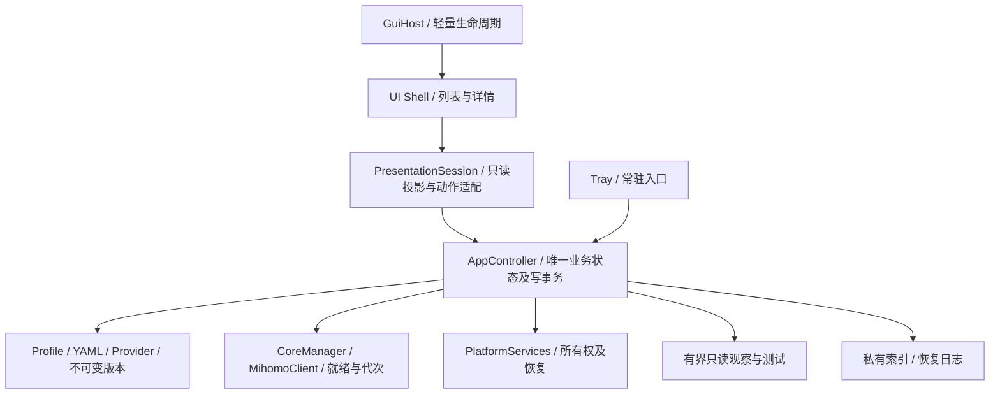

# U09 系统设计：从任务到接口

状态：设计提案，未实施。以 [UI 设计](../ui-u09-shadowrocket.md) 为输入；下文新类型与接口为建议，不声称已存在。AppController 单写入者、异步 I/O、版本分离和写前恢复保持。

## 1. 功能定义

| ID | 目标 | 输入 → 可观察结果 | 不允许的隐式行为 |
|---|---|---|---|
| UX-CONNECT | 了解/改变系统代理连接 | 明确开/关 → 归属、就绪和错误 | 浏览节点不接管，TUN 不由同一开关猜测启停 |
| UX-SELECT | 切换手动组成员 | group+member → 实际 now | 自动组不固化，不自动选最快 |
| UX-TEST | 测节点或目标 | node+URL → 实际结果/时间 | 响应不代表带宽或解锁 |
| UX-CONFIG | 维护并使用配置 | 来源/草稿 → candidate/active/LKG | 下载不覆盖运行版，浏览不激活 |
| UX-RULE | 调整配置分流 | 对象版本+草稿 → 校验及安全提交 | 内核规则不冒充未保存草稿 |
| UX-OBSERVE | 定位流量问题 | 可见任务 → 有时效快照 | 隐藏不保留敏感连接历史 |
| UX-PREF | 修改偏好/网络参数 | 明确编辑 → 即时保存或重启事务 | 旧网络草稿不夹带到偏好提交 |
| UX-MAINTAIN | 备份/恢复/换内核 | 预览/确认 → 新增恢复或可回退应用 | 不自动运行恢复配置、不放宽特权边界 |

已有能力保留，变化以入口和对象语义为主。截图的 Wi-Fi 上传、Tailscale、模块、独立默认配置与多语言不在本轮新增；不能用占位表示已支持。

状态词汇：浏览配置/组/预选属于 UI 上下文；当前配置/成员/模式必须回读确认；意图、就绪、系统代理归属与 TUN 观测独立；pending 是未完成，不提前勾选；candidate/active/lastGood 是不同版本身份。

## 2. 架构

PresentationSession 是建议的 UI 适配集合，不是第二个 Controller，不发 HTTP、不启动进程、不写文件或索引。Widget/QML 都只消费只读模型和有限命令。表现层销毁不能销毁已接纳的业务事务；只读请求局部取消，不使用全局 cancelAll 干扰写操作。

| 数据 | 唯一来源 | 生命周期 |
|---|---|---|
| 配置/偏好/版本引用 | ProfileStore / 加密索引 | 已提交持久化 |
| 核心/代理/TUN 观测 | Controller / OS 回读 | 运行代次 |
| 当前成员 | MihomoClient 回读 | 代次与版本绑定 |
| 浏览/筛选/滚动 | UI Session | 有界非敏感书签 |
| 连接/测试/详细日志 | 观察会话 | 可见性/token，隐藏清理 |
| 编辑草稿 | EditorSession | 提交/取消/窗口寿命 |

## 3. 模块设计

| 模块 | 现状映射 | 设计变化 | 禁止职责 |
|---|---|---|---|
| AppShell / Router | MainWindow、Route、ViewIds | 四区身份/返回统一，兼容留边界 | 业务编排和页号算术 |
| HomePresentation | 首页/代理模型 | 三行投影，浏览与运行分开 | browse 自动 activate |
| ConfigurationPresentation | ProfileRowModel、配置页 | 列表/详情/版本任务共用对象键 | 重复 YAML/凭据缓存 |
| DataPresentation | ConnectionSession、WebsiteTests、日志 | 页签可见性租约与新鲜度 | 隐藏无限刷新 |
| SettingsPresentation | 设置页/工具窗口 | 目录与详情，重启草稿独立 | 全量旧设置覆盖新设置 |
| EditorSession | 草稿保护、工具注册表 | 同工具同对象唯一、期望快照 | 将保存失败画成成功 |
| UiComponents / Theme | UiTheme、WidgetStyle、委托 | 有限组件，命中和语义统一 | 散落样式/动态销毁样式树 |
| GuiHost / Tray | 现有独立生命周期 | QML 时显式引擎/窗口销毁 | GUI 全局单例阻止回收 |

不建立大量空模块或新通用 MVVM 框架。先提取真实重复逻辑，一个模块可为已有类中受控结构，按职责和可测试性拆文件。引擎/平台安全实现不为换渲染重写。

## 4. 协议设计

### 4.1 进程内命令与事件（建议）

命令绑定稳定对象键，不传行号。Envelope 的逻辑字段为 requestId、action、objectKey、expectedGeneration、expectedVersion、payload；仅按所需任务引入，不强制一次重写所有公开方法。

事件分 Accepted / Progress / Completed / Rejected。Accepted 不表示生效；Completed 必须包含实际观测确认。Progress 为具名 stage 和可选实际进度，不伪造百分比。每 request 最多一个终态，旧 token/generation 结果丢弃。

建议错误码 Busy、StaleContext、Unsupported、InvalidInput、Conflict、Cancelled、TimedOut、RecoveryRequired、Unavailable。现有 Result 仅 ok/error/data；新增错误码需单独契约与兼容回归，不能按中文字符串驱动逻辑。

取消分为只读 token 局部取消与写事务安全收敛。关闭编辑器只停止其观察，不杀核心；已接纳写操作的结果应回到仍存活的操作状态投影。

### 4.2 控制面与进程协议（保持）

回环控制面、随机 Secret、NoProxy、PID/端口归属、禁止重定向及写后回读保持。GET /proxies、/configs、/connections、/rules、/logs 与 delay 仍由 MihomoClient 封装；QML/Widget 不拼 API URL、不持有 Secret。

校验、启动、停止仍由异步 QProcess 或受限服务会话负责，沿用现有超时。细则以 [API 契约](../api-contracts.md) 为准，UI 不增加开放控制端口。

### 4.3 特权与持久化协议（不随换肤重定义）

TUN 的账户绑定会话、允许列表、固定核心和写前恢复保持。S3 意图/观测分离需独立 ADR；未完成前不得将 tunObserved 一个 bool 当成完整服务就绪状态。

索引/版本/备份沿用加密和原子事务格式。UI 路由不存来源、连接快照和凭据。书签如要新增持久字段，先定义 schema、兼容和隐私预算；本设计默认只保留非敏感会话书签。

## 5. 接口设计（建议映射）

| UI 意图 | 现有映射 | 前置/完成条件 | 需调整处 |
|---|---|---|---|
| browseConfiguration | UI 选择 | 对象存在，不写 | 移除 combo change 与 activate 的耦合 |
| useConfiguration | activateProfile | 期望版本未变 → 事务/回读 | 薄适配绑定版本 |
| selectNode | selectMember | Selector/成员/代次合法 → now 回读 | pending/current 分开 |
| connectSystemProxy | setProxyEnabled | 必要接管确认 → 归属/就绪回读 | UI checked 不是 observed |
| changeRoutingMode | setMode | 已就绪/可写 → configs 回读 | 菜单实际值与 pending |
| testNode/cancel | testNodes/cancelTests | 冻结对象/URL和局部 token | 单测/整组取消范围清楚 |
| update/preview/apply | updateProfile/变化预览/activate | candidate 独立，比较版本匹配 | 三动作不能合成一个“更新” |
| setVisibleTask | PageLifecycle/可见性命令 | 当前页签拥有 lease | 销毁释放全部读取租约 |
| savePreferencePatch | updateSettings（现全量） | 只改目标字段、失败恢复 | 建议 patch 适配，禁止旧草稿覆盖 |
| applyNetworkDraft | 既有设置事务 | 显式提交、校验与重启 | expected snapshot、具名阶段 |
| openEditor | ToolWindowRegistry | 同对象复用，删除关闭/保护 | QML 也沿用约束 |

这些是任务接口意图，不要求原样新增一组同名方法。实现先做一条纵向任务，更新公开契约及消费者；禁止并存两套不一致 API。

建议只读模型：ConnectionSummary（意图/归属/就绪/说明/pending）；NodeRow（stableKey/name/protocol/locationHint/delayState/current/pending/capabilities）；ConfigurationRow（sourceKind/active/candidate/updated/maintenance）；OperationStatus（requestId/object/stage/outcome/recovery）。不把可写 AppController 整体暴露给 QML。

## 6. 功能设计与异常流程

### F01 使用配置与连接

浏览 → 配置详情/候选 → 使用此版本 → 必要的保护备份 → 校验/释放旧代理/停止/启动/回读/保存/恢复意图 → 实际当前。失败沿既有 LKG/恢复事务收敛，浏览不触发此流程。

开启系统代理检查配置/核心，必要时先启动；外部接管明确确认，写前记录 → 写入 → 完整回读。关闭只恢复完整匹配自身写入的快照；冲突保留 journal 和处理入口，取消确认不改状态。

### F02 节点与测试

叶子点击 → 核对手动组/成员/代次 → pending → PUT → GET → 保存记忆 → 当前勾选。自动组拒绝切换；点击延迟只测不选，排序变化仍以稳定键绑定。旧响应不覆盖新上下文，不清除别的有效卡片结果。

### F03 候选与编辑

下载 → 地址/预算检查 → 来源/Provider 冻结 → 校验候选 → 原子引用。比较显示有界变化，应用再核版本。编辑运行版不消耗独立候选；对象变更后保留草稿、禁止旧窗提交、明确重新加载。

### F04 设置

即时偏好失败回到实际值，重启字段独立草稿并明确保存/校验/重启。外观重应用不得在样式遍历中替换 combo view，不丢焦点；纯偏好不得取消网站测试或重启核心。

### F05 观察与关闭

进入任务 → lease/token → 单在途有界读取 → 时间/新鲜度。暂停冻结，恢复重建速率基线；离页/隐藏/销毁释放 lease、局部 abort、清敏感快照。已授权写操作、托盘及显式维护计划继续。

轻量关闭先处理草稿。Widgets 销毁窗口树；QML 路径须销毁根树/引擎、断开桥接并验证场景图释放，重开重建。Qt/系统库缓存和驱动页面不能保证归零。

## 7. 实施门禁与分片

跨层补充见 [Verge 评审](u09-verge-review.md)：定位、组测试设置、解析链、维护状态和连接转规则草稿优先适配已有功能。NodeRow 增加明确能力/新鲜度/稳定引用；unknown/unresolved 为独立状态，不能用字符串猜测；诊断快照携带配置版本与核心代次，陈旧快照不能给当前对象执行写动作。只借鉴统一请求身份，不复制第二个状态协调器或无界排队。

1. UI 评审：四屏结构、对象语义、失败/取消、键盘、小窗及旧入口映射无歧义。
2. 技术样片：AppShell、GroupedList、NodeRow、Inspector，500 合成节点，只读，不触碰真实 OS。
3. 首条纵向任务：浏览配置 → 明确使用 → 实际成员，复用原事务。
4. 节点/测试/数据会话；随后设置/高级编辑；最后部署与迁移。
5. ADR/API/schema 更改先固化后实施；自动和原生验收分别记录，真实系统/长期资格另列。

设计不自动授权改变 TUN 协议、开放监听或移植其他 OS。QML 允许评估不等于已采用，详见 [选型](u09-technology-review.md)。
